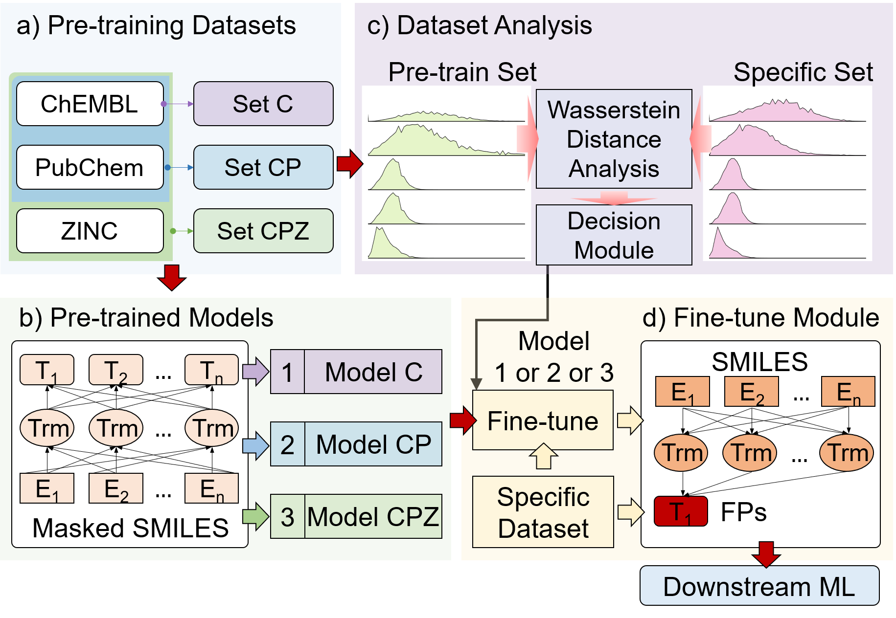

# Extracting Predictive Representations from Hundreds of Millions of Molecules

Source code and pretrained models for the paper **"Extracting Predictive
Representations from Hundreds of Millions of Molecules"** by Dong Chen, Jiaxin
Zheng, Guo-Wei Wei, and Feng Pan.



## Repository Layout

```text
bt_fps/                  Maintained code for model selection and BT-FP extraction
bt_fps/data/             Small data files used by optional model selection
scripts/                 Thin command-line wrappers
examples/data/           Example SMILES and label files
chembl27_512/            Pretrained checkpoint and dictionary
chembl27_pubchem_512/    Pretrained checkpoint and dictionary
chembl27_pubchem_zinc_512/
bt_pro/                  Legacy Fairseq-based code kept for reproduction only
```

The maintained workflow does **not** require Fairseq or Transformers.

## Installation

Create a small environment with PyTorch and NumPy:

```bash
conda create -n bt_embeddings python=3.9 numpy pytorch -c pytorch -y
conda activate bt_embeddings
```

Or install into an existing Python environment:

```bash
pip install -r requirements.txt
```

## Download Pretrained Models

The three pretrained model folders should contain `checkpoint_best.pt` and
`dict.txt`.

```bash
wget https://weilab.math.msu.edu/Downloads/chembl_pubchem_zinc_models.zip
unzip chembl_pubchem_zinc_models.zip
```

Available models:

| Folder | Training data |
| --- | --- |
| `chembl27_512` | ChEMBL27 |
| `chembl27_pubchem_512` | ChEMBL27 + PubChem |
| `chembl27_pubchem_zinc_512` | ChEMBL27 + PubChem + ZINC |

## Optional Model Selection

The model-selection utility estimates which pretrained model is closest to a
target SMILES dataset by the Wasserstein-distance feature scheme used in the
original project.

```bash
python scripts/select_pretrained_model.py \
  --input-dataset examples/data/example.smi
```

The script is NumPy-only and resolves its own data files from `bt_fps/data/`.
It prints the selected model folder and the three selector scores.

## Generate BT-FP Fingerprints

Use `scripts/extract_fingerprints.py` to extract molecular embeddings from any
of the pretrained model folders.

```bash
python scripts/extract_fingerprints.py \
  --model-dir chembl27_512 \
  --smi-file examples/data/example.smi \
  --output outputs/example_chembl27_bos.npy \
  --feature-type bos
```

Output shape is:

```text
number_of_non_empty_smiles x 512
```

Feature pooling options:

- `bos`: first-token hidden state. This matches the original
  `bt_pro/generate_bt_fps.py` behavior.
- `avg`: average hidden state over non-padding tokens.

To use a different pretrained model:

```bash
python scripts/extract_fingerprints.py \
  --model-dir chembl27_pubchem_512 \
  --smi-file examples/data/example.smi \
  --output outputs/example_chembl27_pubchem_bos.npy \
  --feature-type bos
```

## Task-Specific Fingerprints

For most downstream tasks, the recommended workflow is:

1. Put one canonical SMILES string per line in a `.smi` file.
2. Optionally run model selection.
3. Extract BT-FPs with the selected pretrained model.
4. Train the downstream regression or classification model with the generated
   `.npy` feature matrix.

Example:

```bash
python scripts/select_pretrained_model.py \
  --input-dataset examples/data/regression_example/regression_train_canonical.smi

python scripts/extract_fingerprints.py \
  --model-dir chembl27_512 \
  --smi-file examples/data/regression_example/regression_train_canonical.smi \
  --output outputs/regression_train_bt_fps.npy \
  --feature-type bos

python scripts/extract_fingerprints.py \
  --model-dir chembl27_512 \
  --smi-file examples/data/regression_example/regression_valid_canonical.smi \
  --output outputs/regression_valid_bt_fps.npy \
  --feature-type bos
```

If you already have a fine-tuned checkpoint with the same architecture, you can
extract fingerprints from it as well:

```bash
python scripts/extract_fingerprints.py \
  --model-dir path/to/finetuned_model \
  --dict-file chembl27_512/dict.txt \
  --smi-file path/to/test.smi \
  --output outputs/test_finetuned_bt_fps.npy \
  --feature-type bos
```

## Legacy Fairseq Code

`bt_pro/` contains the original vendored Fairseq training code used by the
previous project. It is kept for paper reproduction and historical fine-tuning
experiments, but it is no longer part of the default installation path. New
feature extraction and model selection should use `bt_fps/` and `scripts/`.

The new extractor was checked against the old `bt_pro/generate_bt_fps.py`
outputs for the provided checkpoints; differences are at normal float precision
level.

## License

All code released in this study is under the MIT License.

